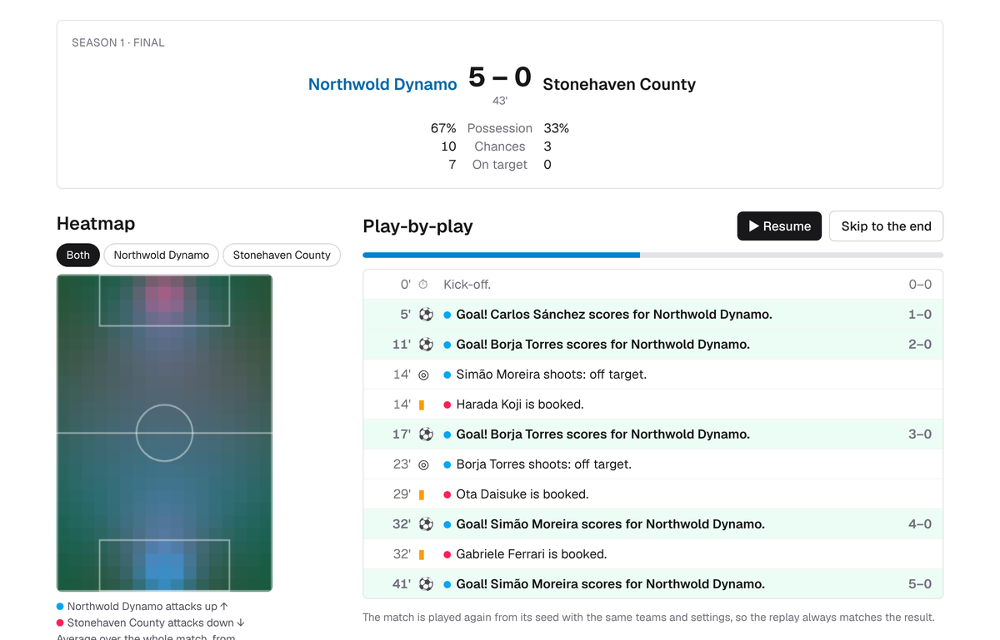
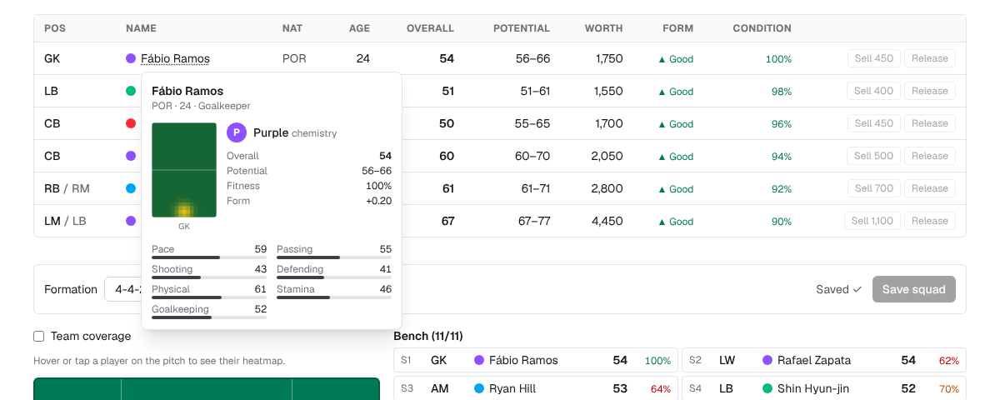
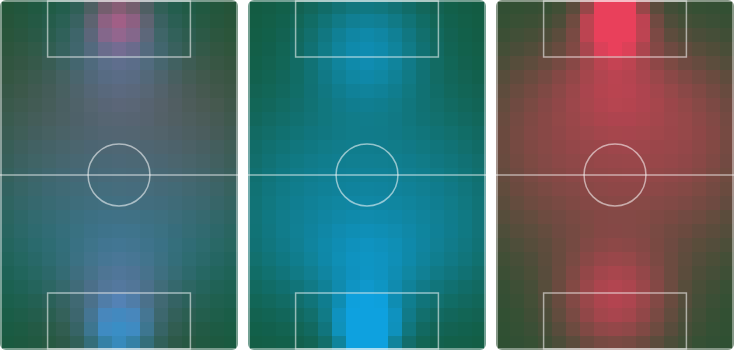
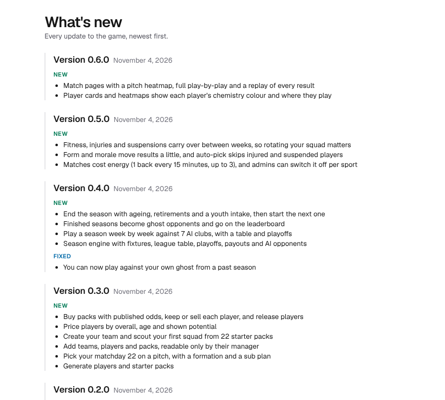

# LiterallyFantasySports

It's literally fantasy sports: a free, browser-based sports management game. Collect
generated players, set your matchday squad and play seasons against AI clubs and the
"ghosts" of other managers' finished seasons. Soccer comes first; the engine is built
so more sports can follow.

Play at [www.literallyfantasysports.com](https://www.literallyfantasysports.com).



## How it plays

- **Build a club.** Name it, open 22 free starter packs and keep the 22 to 30 players
  you like. Each player has attributes, a position (and maybe a second one), an age,
  a rough potential range and a chemistry colour.
- **Pick your matchday 22.** Choose a formation, drag players onto the pitch and the
  bench, and plan substitutions. Starters who share a chemistry colour get a boost.
- **Play a season.** Eight clubs, home and away over 14 weeks, then playoffs for the
  top 4. Each week costs 1 energy, which comes back over time. Matches pay out, Elo
  moves, and fitness, injuries, suspensions, form and morale carry from week to week.
- **Watch it back.** Every result opens a match page with a heatmap of where each
  team had influence, the full play-by-play, and a minute-by-minute replay. Matches
  are simulated from a seed, so a replay always matches the result.
- **Keep going.** At season end players age, grow toward their potential or decline,
  and some retire; a youth intake brings in new prospects. Your finished season goes
  on the leaderboard and lives on as a ghost in other managers' leagues.
- **Buy packs** with your earnings: published odds, all positions or a position focus.

| Player cards | Where each team played |
| --- | --- |
|  |  |

Updates are listed in the game on the [What's new](https://www.literallyfantasysports.com/whats-new)
page.



## How it's built

A pnpm + Turborepo monorepo in TypeScript.

| Path | What |
| --- | --- |
| `apps/web` | Next.js app: pages, server actions, sign-in, admin |
| `packages/core` | Sport-agnostic engine: seeded random numbers, Elo, influence grids, chemistry, names, seasons, energy |
| `packages/sport-soccer` | Soccer: positions, attributes, player generation, packs, the match sim, seasons, ghosts, replays |
| `packages/db` | Database schema, migrations and security-rule tests |

The game rules live in the engine packages, which are pure TypeScript with no I/O, so
every match can be replayed exactly. The web app loads data, calls the engine and saves
the results; matches only ever run on the server. Data lives in Supabase (Postgres) with
row-level security on every table, and the site is hosted on Vercel.

Admins can paint each position's influence template, change match tuning, payouts and
pack prices, and switch energy off, all without a deploy.

## Development

Requires Node 22 and pnpm 10.

```bash
pnpm install
```

```bash
pnpm dev
```

Then open http://localhost:3000. Other commands: `pnpm lint`, `pnpm typecheck`,
`pnpm test`, `pnpm build`, and `pnpm --filter @lfs/sport-soccer harness 10000` to play
10,000 matches and print goal and draw statistics.

## Docs

- [Project roadmap and decision log](project_roadmap.md)
- [Setup guide](m0_setup_guide.md)
- [Rules for Claude Code sessions](CLAUDE.md)
- [Architecture decisions](docs/adr/)

## License

[MIT](LICENSE)
